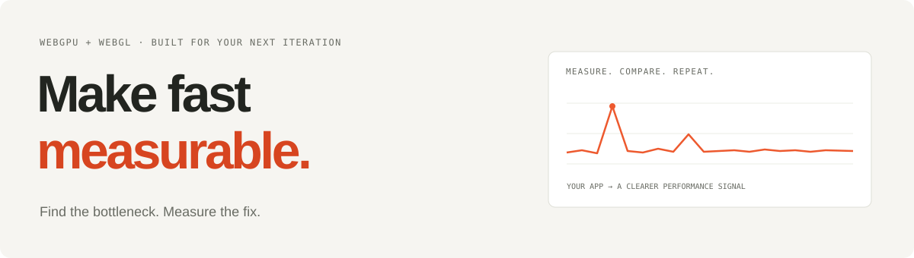

# GPU Performance Agent

[](https://makio64.github.io/gpu-perf-agent/)

Give your coding agent real WebGPU and WebGL measurements. Find bottlenecks, optimize your app, and verify the improvement.

[Website](https://makio64.github.io/gpu-perf-agent/) · [npm](https://www.npmjs.com/package/gpu-perf-agent) · [Full reference](https://github.com/Makio64/gpu-perf-agent/blob/master/docs/reference.md) · [Agent skill](https://github.com/Makio64/gpu-perf-agent/blob/master/skill/SKILL.md)

## Install once. Then just ask.

Same install command for **Codex, Claude Code, Gemini CLI**, and [other supported agents](https://github.com/vercel-labs/skills#supported-agents):

```bash
npx skills add Makio64/gpu-perf-agent -g
```

Choose your agent when prompted. Start a new agent session in your project, then ask:

```text
Use gpu-perf-agent to optimize the webgpu performance
```

The skill runs the profiler through `npx`; no separate global profiler install is needed. Omit `-g` to install the skill only in the current project.

<details>
<summary><b>Manual install / where each agent looks</b></summary>

Copy the whole `skill/` folder (SKILL.md plus `references/`) to a folder named `gpu-perf-agent` in the agent's global skills directory, then start a new agent session:

| Agent | Global skills directory | Check |
| --- | --- | --- |
| Claude Code | `~/.claude/skills/gpu-perf-agent/` | `/skills` |
| Codex | `~/.agents/skills/gpu-perf-agent/` (also scans the legacy `~/.codex/skills/`; keep only one copy) | `/skills` |
| Cursor | `~/.agents/skills/gpu-perf-agent/` or `~/.cursor/skills/gpu-perf-agent/` (also reads `~/.claude/skills` and `~/.codex/skills`) | `/skills` in `cursor-agent`, or Settings → Rules, Skills |
| Antigravity (App and `agy`) | `~/.gemini/config/skills/gpu-perf-agent/` | `/skills` in `agy` |

`npx skills add -a antigravity` writes to the legacy IDE folder `~/.gemini/antigravity/skills/`, which current Antigravity releases do not read; use the manual copy above. Do not put user skills in `~/.cursor/skills-cursor/`: Cursor manages that folder and removes folders it does not own.

</details>

**Requires Node.js 22+, Git, and Chrome/Chromium.**

## Prefer the terminal?

Start your app, then point the profiler at it:

```bash
npx gpu-perf-agent agent --url http://localhost:5173 --out reports/base.json
```

A short digest lands in your terminal. Full measurements are saved to JSON. No changes to your app required.

**Requires Node.js 22+ and Chrome/Chromium.** The default runner has zero required npm dependencies. Check your setup with `npx gpu-perf-agent doctor --quick`.

## What you get

- **Find expensive work.** Frame pacing, slow frames, draw calls, declared GPU allocations, and actionable warnings.
- **Check whether a change helped.** Before/after comparisons, confidence intervals, and regression budgets.
- **Keep agents focused.** Compact output, structured JSON, a bundled skill, and a built-in MCP server.
- **Iterate without the startup tax.** Reuse Chrome while each capture gets an isolated browser context.

## Make a change. Measure it again.

Capture and screen the candidate against the baseline in one command, then confirm GPU deltas with interleaved A/B rounds:

```bash
npx gpu-perf-agent agent --url http://localhost:5173 --base reports/base.json --out reports/cand.json
npx gpu-perf-agent ab --base-url http://localhost:4173 --candidate-url http://localhost:5173
```

The comparison reports regressions, improvements, directional screening (`screen: better|worse|same`), and inconclusive results. Invalid measurements are flagged explicitly. Exit codes: `0` valid / passing / unverified / inconclusive, `1` regression or budget failure, `2` invalid or incompatible evidence, `3` CLI or runner error.

For more confidence, use [interleaved A/B runs](https://github.com/Makio64/gpu-perf-agent/blob/master/docs/reference.md#interleaved-ab-measurements) or enforce a [performance budget](https://github.com/Makio64/gpu-perf-agent/blob/master/docs/reference.md#baseline-and-candidate-reports).

## Pick your workflow

| You want to… | Use |
| --- | --- |
| Inspect a visual report | `npx gpu-perf-agent agent --url http://localhost:5173 --html` |
| Profile a static build | `npx gpu-perf-agent agent --file dist/index.html --file-root dist` |
| Get machine-readable output | Add `--json` |
| Connect an MCP client | `npx gpu-perf-agent mcp` |
| Keep Chrome ready for repeated jobs | `npx gpu-perf-agent serve --port 9099 --auto-instrument` |

For the persistent server, add `--server http://127.0.0.1:9099` to your capture command. Use the [Node API](https://github.com/Makio64/gpu-perf-agent/blob/master/docs/reference.md#node-api) to integrate directly, or the [agent skill](https://github.com/Makio64/gpu-perf-agent/blob/master/skill/SKILL.md) to teach your assistant the workflow.

## Know what you’re measuring

Frame timing observes browser cadence. `agent` and `ab` time WebGPU passes and WebGL2 frames automatically; use [timing hooks](https://github.com/Makio64/gpu-perf-agent/blob/master/docs/reference.md#precise-gpu-timestamps) for warm, fixed-work or custom-scope GPU measurements. Allocation tracking estimates declared storage, not physical VRAM residency. Compare the same scene and capture settings; use more samples when results are inconclusive.

[Read the full reference →](https://github.com/Makio64/gpu-perf-agent/blob/master/docs/reference.md)

---

[What’s new](https://github.com/Makio64/gpu-perf-agent/blob/master/CHANGELOG.md) · [Measured tool overhead](https://github.com/Makio64/gpu-perf-agent/blob/master/OPTIMIZATION.md) · [Examples](https://github.com/Makio64/gpu-perf-agent/tree/master/examples) · [MIT license](https://github.com/Makio64/gpu-perf-agent/blob/master/LICENSE)
